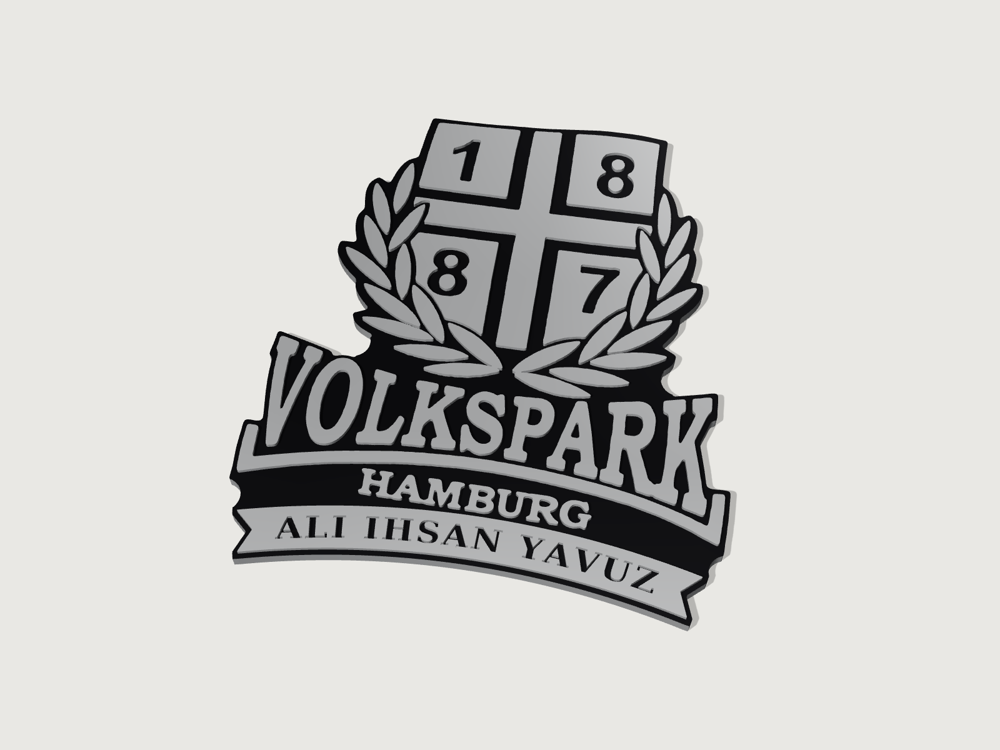

# Abschiedsgeschenk für Ali Ihsan Yavuz – CNC-Frästeil aus Aluminium



## Aufbau

Ein konturgefrästes Teil (folgt dem Umriss der Motive) mit 2,5D-Relief, von oben nach unten:

1. **1887-Wappen** mit Kreuz und Lorbeerkranz
2. **VOLKSPARK HAMBURG**
3. **Namensband „ALI IHSAN YAVUZ“** (Bogen parallel zum VOLKSPARK-Schwung, Band passt sich automatisch der Namenslänge an)

Die grauen Stickflächen der Aufnäher sind **erhaben** (volle Materialstärke). Die schwarzen Flächen sind **vertieft** und lassen sich optional schwarz auslegen. Dann sieht das Teil aus wie die Aufnäher.

| Kennwert | Wert |
|---|---|
| Außenmaß | 239,9 × 290,8 mm |
| Materialstärke | 8,0 mm |
| Relief- / Taschentiefe | 2,0 mm (Taschenboden bei 6,0 mm) |
| Volumen / Masse (Alu, ρ = 2,7 g/cm³) | 373 cm³ / ca. 1,0 kg |
| Engster schwarzer Spalt zwischen erhabenen Flächen | 1,20 mm |
| Schmalster schwarzer Rand zur Außenkontur | 2,55 mm |
| Dünnste vertiefte Schrift (Ziffern / Name) | 2,03 mm |

Alle Werte stehen auch in `output/kennwerte.json`.

## Dateien (`output/`)

| Datei | Zweck |
|---|---|
| `Abschied_Ali_2D.dxf` | **2D-Fräsvorlage** für das CAM (mm, Maßstab 1:1), Layer siehe unten |
| `Abschied_Ali_2D.svg` | Dieselbe 2D-Geometrie als SVG (Inkscape-Ebenen), 1:1 in mm |
| `Abschied_Ali_2D_Zeichnung.pdf/.png` | Zeichnung mit Maßen und Legende zum Ausdrucken |
| `Abschied_Ali_3D.step` | **3D-Volumenmodell** (ein gültiger Solid) für Fusion 360, SolidWorks, Inventor usw. |
| `Abschied_Ali_3D.stl` | 3D-Netz (wasserdicht), z. B. für 3D-CAM oder einen Probedruck |
| `Vorschau_*.png` | Renderings: 3D, Draufsicht lackiert / roh |

### DXF-Layer

| Layer | Bedeutung |
|---|---|
| `KONTUR_DURCH` (rot) | Außenkontur, durch 8 mm fräsen |
| `ERHABEN_INSELN` (blau) | Inseln, die beim Taschenfräsen stehen bleiben |
| `TASCHE_GRENZE` (grau) | Taschenflächen (= Kontur minus Inseln), 2,0 mm tief |
| `INFO` | Textinfo |

## Fertigungsvorschlag (2,5D)

1. Rohteil Alu-Platte ≥ 8 mm, ca. 260 × 310 mm (Rand zum Spannen).
2. Oberfläche planen, falls nötig.
3. **Tasche 2,0 mm tief**: Begrenzung `KONTUR_DURCH`, Inseln `ERHABEN_INSELN`. Schruppen z. B. mit Ø3–4 mm, dann **Restmaterial mit Ø1,0 mm**. Engster Spalt 1,2 mm, Ø1,0 mm passt also durch alle Spalte. Innenecken und spitze Serifen werden dabei mit r = 0,5 mm verrundet, das ist normal.
4. **Außenkontur** `KONTUR_DURCH` durchfräsen (Ø3 mm oder kleiner; Kerben unter 3 mm sind in der Kontur schon geschlossen). **Haltestege** setzen.
5. Stege versäubern und entgraten.
6. Optional: Vertiefungen schwarz auslegen (Lack oder Emaille), Überstand auf den erhabenen Flächen abziehen bzw. planschleifen. Danach bürsten oder polieren, eventuell klar lackieren.

Die Fräsparameter (Drehzahl, Vorschub, Zustellung) hängen von Maschine und Werkzeug ab. Die lege ich hier bewusst nicht fest.

## Anpassen und neu erzeugen

Alle Parameter stehen oben in `tools/design.py` (`PARAMS`): Größen, Stärke, Relieftiefe, Name, Schrift, Bandform, Mindestspalt.

```bash
pip install trimesh shapely numpy pillow opencv-python-headless manifold3d matplotlib scikit-image ezdxf fonttools mapbox-earcut cadquery-ocp
```

```bash
python3 tools/build.py
```

`--no-step` überspringt den STEP-Export, der dauert ca. 15 s. Die 3D-Renderings kommen aus `tools/render3d/` (three.js 0.160 + Playwright). Dafür `three` per npm installieren, als `three/` neben `index.html` verlinken, `model.stl` dazulegen und einen lokalen HTTP-Server auf Port 8765 starten.

## Hinweise und Grenzen

- **Aus Fotos vektorisiert:** Wappen und VOLKSPARK-Schriftzug sind aus den beiden Aufnäher-Fotos nachgezeichnet und geglättet. Sie entsprechen den Aufnähern optisch, sind aber keine Originalvektordaten. Kleine Abweichungen (leicht wellige Kanten wie bei Stickerei) sind möglich.
- **Engstellen leicht aufgeweitet:** Damit ein Ø1,2-mm-Fräser überall durchpasst, wurden sehr enge schwarze Spalte (v. a. zwischen Lorbeerblättern) lokal um wenige Zehntel aufgeweitet.
- **Schrift des Namens:** DejaVu Serif Bold. Sie passt zum Stil von „HAMBURG“, ist aber nicht dieselbe Schrift.
- **Schreibweise:** Umgesetzt ist „ALI IHSAN YAVUZ“, so wie angegeben. Auf Türkisch schreibt man den Namen mit Punkt auf dem großen I: „ALİ İHSAN YAVUZ“. Das ist eine Zeile in `PARAMS["name_text"]`, falls gewünscht.
- **Motive Dritter:** Die Motive stammen von Fan-Aufnähern. Für ein privates Einzelstück als Geschenk halte ich das für unkritisch. Das ist eine Einschätzung, keine Rechtsberatung. Nicht zum Verkauf verwenden.
